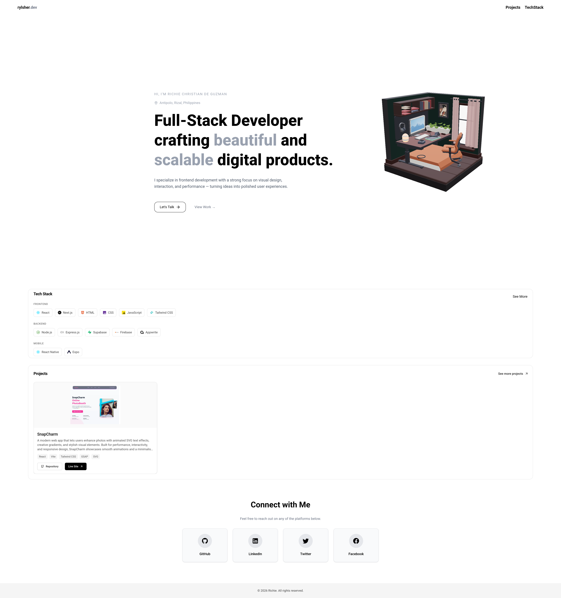
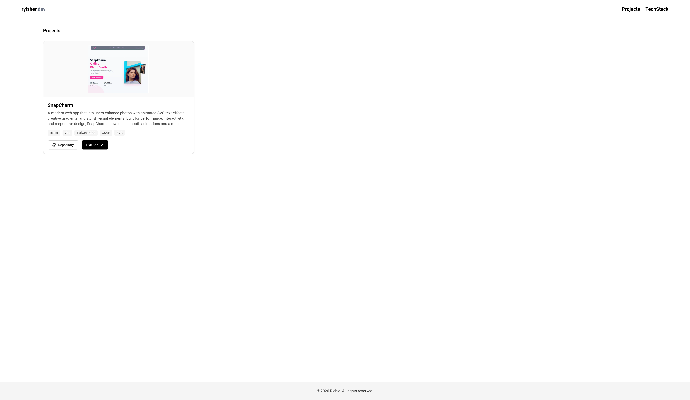
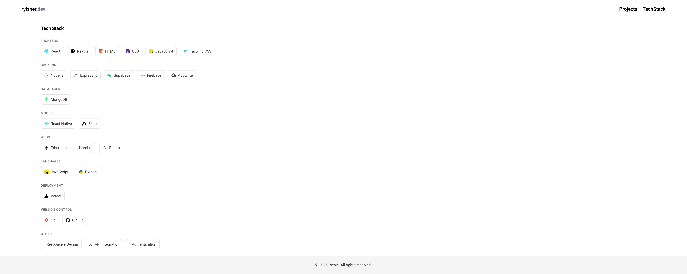

# Richie Christian De Guzman – Portfolio

A modern, minimalist developer portfolio showcasing my projects, tech stack, and socials.  
Built with performance, responsiveness, and clean UI in mind.

🌐 Live Site: https://richie-christian-de-guzman.vercel.app/

---

## Preview

### Desktop View

---

## Tech Stack

- **Framework:** Next.js (App Router)
- **Frontend:** React, TypeScript
- **Styling:** Tailwind CSS
- **UI / Icons:** Lucide, Iconify
- **Animations:** GSAP, Framer Motion
- **3D:** React Three Fiber, Drei
- **Carousel:** Embla Carousel
- **Deployment:** Vercel

---

## Features

- Fully responsive design (mobile → desktop)
- Interactive project carousel
- Dedicated projects page
- Socials page with external links
- Contact form UI
- Smooth micro-interactions and hover states
- Optimized images with `next/image`
- Clean, minimalist aesthetic

---

## Pages

Single-page site — all sections scroll on one page:

- **Home** – Hero with role badges, stats, and CV download
- **Tech Stack** – Frontend, backend, mobile, Web3, data, cloud
- **Projects** – Interactive project carousel
- **Achievements** – Hackathons, honors, and certifications
- **LinkedIn** – Live posts pulled from LinkedIn
- **Connect** – Social links and contact

## API

- `/api/linkedin` – Server-side pipeline that pulls live post data from LinkedIn, with fallback to static data.

---

